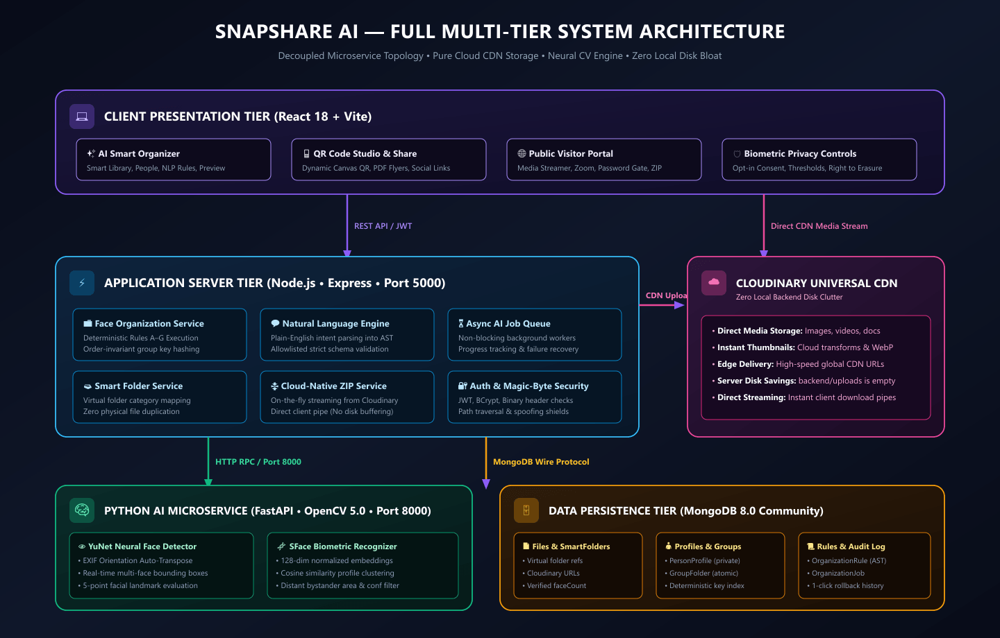
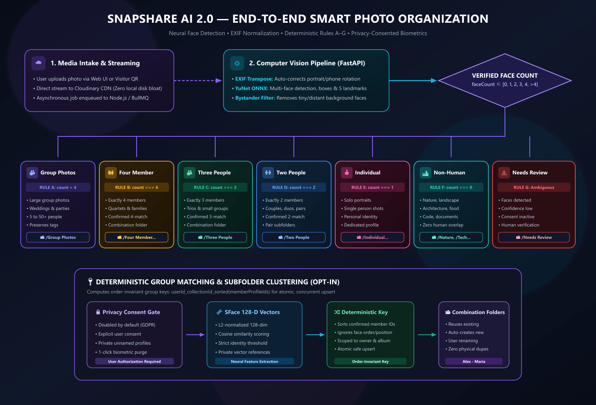

# SnapShare AI v2.0 — Universal QR-Based File Sharing & Intelligent Photo Organization Platform

> **Share Everything. Scan Once. Organize Intelligently.**  
> A production-grade SaaS application combining seamless universal multi-device file sharing via dynamic branded QR codes with a deep neural computer vision engine, deterministic face-based photo organization, and a natural language organization command center.

---

## 📑 Table of Contents
1. [Overview & Vision](#-overview--vision)
2. [Key Capabilities](#-key-capabilities)
3. [AI & Computer Vision Architecture](#-ai--computer-vision-architecture)
4. [Deterministic Rule Engine (Rules A through G)](#-deterministic-rule-engine-rules-a-through-g)
5. [Natural Language Organization Command Center](#-natural-language-organization-command-center)
6. [Privacy-First Biometrics & People Library](#-privacy-first-biometrics--people-library)
7. [Zero-Local-Footprint Cloud Storage](#-zero-local-footprint-cloud-storage)
8. [Universal QR Sharing & Visitor Portal](#-universal-qr-sharing--visitor-portal)
9. [Technology Stack](#-technology-stack)
10. [Directory Structure](#-directory-structure)
11. [Quick Start & Local Deployment](#-quick-start--local-deployment)
12. [API Reference](#-api-reference)
13. [Security & Privacy Standards](#-security--privacy-standards)

---

## 🚀 Overview & Vision

SnapShare was originally conceived as a lightning-fast, universal file-sharing platform designed to eliminate the friction of transferring documents, media, and archives across disparate operating systems and devices. By pairing multi-file collections with cryptographically validated storage and instant, dynamic, customizable QR codes, SnapShare enabled users to distribute content to groups, events, and clients without requiring recipients to install proprietary native applications or configure complex cloud permissions.

With **SnapShare AI 2.0**, the platform expands into an enterprise-grade intelligent photo organizer. In real-world events, weddings, professional photo shoots, and family gatherings, photographers and event hosts routinely capture thousands of high-resolution images. Manually sorting these photographs into individual portraits, couple photos, small family groups, and large group gatherings is tedious, time-consuming, and prone to human error.

SnapShare AI 2.0 solves this challenge autonomously. Operating through a high-performance Python FastAPI microservice powered by OpenCV 5.0 deep neural networks, SnapShare inspects uploaded photographs, detects human faces, auto-corrects orientation from EXIF metadata, optionally extracts privacy-consented facial embeddings, and deterministically categorizes every photograph into structured virtual smart folders. Combined with an AI-driven Natural Language Command Center, users can instruct the platform in plain conversational English, preview the organization in dry-run mode, and approve or roll back folder assignments with a single click.

---

## 🌟 Key Capabilities

### 1. Neural Multi-Face Detection
- Employs the **YuNet ONNX** deep convolutional network for real-time face detection, bounding box generation, 5-point facial landmark mapping, and confidence assessment.
- Handles diverse lighting conditions, varied angles, partial occlusions, and distant subjects.
- Applies automated **EXIF orientation transposition**, ensuring portrait smartphone photos and rotated camera captures are accurately oriented before neural evaluation.
- Implements **foreground subject isolation**, dynamically filtering out distant, low-confidence background pedestrians so intimate couple and portrait photos are never corrupted by ambient bystanders.

### 2. Deterministic Smart Organization (Rules A–G)
- Categorizes photographs into a hierarchical virtual folder system:
  - **Group Photos**: Large gatherings and group shots containing more than 4 people.
  - **Four Member Groups**: Photographs containing exactly four individuals.
  - **Three People**: Photos containing exactly three individuals.
  - **Two People**: Intimate pair and couple photographs containing exactly two individuals.
  - **Individual Photos**: Solo portraits and single-person captures.
  - **Non-Human / Scenery**: Strictly excludes landscapes, architecture, nature, and object captures from all human and group folders.
  - **Needs Review**: Holds ambiguous or uncertain detections for human verification without making erroneous assumptions.

### 3. Natural Language Rule Engine
- Users type commands in natural, conversational English (e.g., *"If a photo contains more than four people, put it in Group Photos. For two people, create a pair folder."*).
- An AI semantic compiler parses the instruction into a strictly typed, allowlisted JSON Abstract Syntax Tree (AST), ensuring zero arbitrary code execution.
- Provides a real-time dry-run preview, a visual folder hierarchy breakdown, and a historical action log with 1-click rollback capabilities.

### 4. Privacy-First Biometric Matching & People Library
- **Disabled by default**: Facial embeddings are never generated or stored without explicit, affirmative user consent.
- Uses **SFace ONNX** normalized 128-dimensional embedding vectors stored privately and strictly scoped to the owner's account.
- Allows users to rename private profiles (e.g., rename *Person #1* to *Alex*), merge duplicate clusters, split incorrect groupings, and permanently purge all biometric data at any time.

### 5. Pure Cloud Storage & Zero Disk Bloat
- Eliminates redundant local disk duplication. Uploads stream directly to **Cloudinary CDN**, generating high-speed URLs for instant rendering across web, tablet, and mobile clients.
- The backend `uploads` directory remains completely clean of permanent assets, preventing disk exhaustion on production servers.

---

## 🧠 AI & Computer Vision Architecture

The AI subsystem operates as an independent, lightweight microservice decoupled from the Node.js API server to maintain horizontal scalability and computational isolation.

<p align="center">
  
</p>

### The Analytical Pipeline:
1. **Intake & Streaming**: When a user uploads media or triggers auto-organization, the Node.js queue dispatches a background task referencing the cloud CDN URL.
2. **EXIF Normalization**: The Python microservice inspects image metadata and applies `ImageOps.exif_transpose` to rotate raw sensor pixels to their true upright coordinate system.
3. **Neural Face Detection**: The pre-trained YuNet ONNX model scans the image across multiple pyramid scales, returning bounding boxes, detection confidences, and 5 facial landmark positions (left eye, right eye, nose tip, left mouth corner, right mouth corner).
4. **Foreground Subject Isolation**: An adaptive area and confidence filter isolates primary subjects from low-confidence background pedestrians.
5. **Feature Embedding (Opt-In)**: If the user has explicitly enabled face matching, the cropped face regions are passed to the SFace recognizer, outputting L2-normalized 128-dimensional vectors.
6. **Cosine Similarity Matching**: Face vectors are compared against the user's private person profiles using cosine similarity with a strict identity threshold (default `0.85`–`0.95`).

---

## 📐 Deterministic Rule Engine (Rules A through G)

SnapShare AI strictly separates face counting from identity matching to maintain deterministic accuracy:

<p align="center">
  
</p>

### The Rules:
- **Rule A (`faceCount > 4`)**: Photographs containing more than four people are placed directly into `Group Photos`.
- **Rule B (`faceCount === 4`)**: Routed strictly to `Four Member Groups`. If all four individuals have confirmed profiles and matching consent is active, a deterministic group key (`userId_collectionId_sortedMemberIds`) creates or reuses an exact four-member combination folder.
- **Rule C (`faceCount === 3`)**: Routed strictly to `Three People` (or reusable three-member subfolders when consented).
- **Rule D (`faceCount === 2`)**: Routed strictly to `Two People` (or reusable pair subfolders when consented).
- **Rule E (`faceCount === 1`)**: Routed strictly to `Individual Photos` (or personal profile folders when consented).
- **Rule F (`faceCount === 0`)**: Routed to generic semantic categories (e.g., Nature, Architecture, Technology, Documents). Zero-people photos are strictly excluded from all human and group folders.
- **Rule G (Uncertain / Incomplete)**: If human faces are detected but profile matching fails confidence thresholds, the image is held in `Needs Review` for optional manual confirmation.

---

## 💬 Natural Language Organization Command Center

SnapShare features an interactive conversational command interface that bridges natural human instructions with deterministic backend execution.

### How It Works:
1. **Natural Input**: The user enters an instruction such as:
   > *"If a photo contains more than four people, put it in Group Photos. For exactly two people, place in Two People."*
2. **Semantic Interpretation**: The rule engine parses the text, matching intent patterns against an allowlisted schema.
3. **Structured Validation**: Arbitrary keys or disallowed actions are rejected. The output is a validated, structured rule representation.
4. **Interactive Dry-Run Preview**: The system simulates folder distribution over the current library without altering live database records, reporting exact file counts and target folder hierarchies.
5. **Execution & Rollback**: Once approved, the backend executes the folder assignments atomically and records an audit log entry. The user can roll back the entire batch at any time with a single click.

---

## 🔒 Privacy-First Biometrics & People Library

Biometric data security is built into the architecture from the ground up:

- **Strictly Opt-In**: Face embedding generation is disabled by default. The platform will never compute or persist face embeddings unless explicit consent is toggled in **AI Preferences**.
- **No Real-World Identity Association**: SnapShare never connects to external identity databases or social networks. All profiles are initially generated with private, anonymous identifiers (e.g., `Person #1`, `Person #2`).
- **Owner-Scoped Encryption**: Embeddings are marked `select: false` in the Mongoose schema and are strictly isolated to the authenticated user's account.
- **Biometric Right to Erasure**: Users can delete individual profiles, unlink specific photographs, or permanently purge all embeddings and facial analysis history with one button.

---

## ☁️ Zero-Local-Footprint Cloud Storage

To ensure high performance and prevent disk exhaustion on hosting servers, SnapShare implements a pure cloud storage model:

1. **Direct Cloud Upload**: All uploaded images, videos, audio, and documents are streamed to Cloudinary CDN via secure API pipes.
2. **Instant Cleanup**: Any temporary chunks generated in `uploads/temp` during validation are deleted immediately upon successful cloud handshake.
3. **No Local Duplication**: Permanent files and WebP thumbnails are never stored on local server disks (`uploads/files/` and `uploads/thumbnails/` remain completely empty).
4. **Cloud-Native ZIP Creation**: When a user or QR visitor requests a bulk `.zip` download of a collection, the backend streams files directly from Cloudinary into the archive on the fly.

---

## 📱 Universal QR Sharing & Visitor Portal

SnapShare bridges digital cloud assets with the physical world:

- **Dynamic Vector QR Codes**: Automatically created for every collection with customizable color palettes, background styling, and branded embedded logos.
- **Printable PDF Flyers**: Generates print-ready promotional flyers using PDFKit, complete with step-by-step instructions for guests.
- **Public Visitor Portal**: Visitors scanning the QR code access a responsive, mobile-first preview portal supporting:
  - Full-resolution image zoom and rotation
  - In-browser HTML5 video and audio streaming
  - Interactive PDF document embeds
  - Syntax-highlighted source code preview
  - Password protection for confidential shares
  - Collaborative upload toggle (enabling event attendees to upload photos directly to the host's collection)

---

## 🛠️ Technology Stack

| Domain | Technologies & Libraries |
| :--- | :--- |
| **Frontend** | React 18, Vite, Tailwind CSS, Lucide React, Framer Motion, Axios, React Router DOM v7 |
| **Backend** | Node.js (ESM), Express.js, MongoDB 8.0, Mongoose ODM, JWT, Bcrypt, Multer |
| **AI Microservice** | Python 3.13, FastAPI, Uvicorn, OpenCV 5.0, NumPy, Pillow |
| **Computer Vision Models** | YuNet ONNX (Face Detection & Landmarks), SFace ONNX (128-dim Normalized Embeddings) |
| **Cloud Storage** | Cloudinary CDN (Universal Media Storage) |
| **Archiving & Utilities** | Archiver (Streaming ZIP Engine), PDFKit (Flyer Generation), QRCode |

---

## 📁 Directory Structure

```
c:\Internship Project\
├── ai-service/                       # Python FastAPI AI Microservice
│   ├── models/                       # Deep neural network ONNX weights
│   │   ├── face_detection_yunet_2023mar.onnx
│   │   └── face_recognition_sface_2021dec.onnx
│   ├── main.py                       # FastAPI endpoints, YuNet & SFace pipelines
│   └── requirements.txt              # Python dependencies (fastapi, opencv-python, pillow)
│
├── backend/                          # Express.js REST API Server
│   ├── config/                       # Database connection configuration
│   ├── controllers/                  # Route controllers (Auth, AI, Face, Files, Collections, QR)
│   ├── middleware/                   # JWT Auth, Admin verification, Multer upload
│   ├── models/                       # Mongoose Schemas:
│   │   ├── User.js                   # User accounts & AI preferences
│   │   ├── File.js                   # File metadata, face counts, Cloudinary references
│   │   ├── AIAnalysis.js             # Semantic tags, captions, colors, perceptual hashes
│   │   ├── FaceDetection.js          # Detected bounding boxes, landmarks, confidence
│   │   ├── PersonProfile.js          # Private unnamed person profiles & embeddings
│   │   ├── GroupFolder.js            # Deterministic group keys & member profile mappings
│   │   ├── SmartFolder.js            # Virtual smart folders (Two People, Group Photos, etc.)
│   │   ├── OrganizationRule.js       # Natural language rules & JSON AST
│   │   └── OrganizationJob.js        # Background job tracking & history
│   ├── services/                     # Business logic:
│   │   ├── faceOrganizationService.js# Rules A-G execution & group key generator
│   │   ├── smartFolderService.js     # Semantic categorization & smart folder management
│   │   ├── ruleEngineService.js      # Natural language command parser & validator
│   │   ├── aiJobQueue.js             # Background queue coordinating AI microservice
│   │   ├── aiMicroserviceClient.js   # HTTP client communicating with Python service
│   │   ├── cloudinaryService.js      # Cloudinary CDN universal storage provider
│   │   └── zipService.js             # Cloud-native streaming ZIP generator
│   ├── scripts/                      # Testing & migration scripts:
│   │   ├── test_face_organization_suite.mjs # 15-test automated unit/integration suite
│   │   ├── reprocess_all_faces.mjs   # Neural rescan & database synchronization
│   │   └── cleanup_uploads.mjs       # Redundant local file purging script
│   ├── server.js                     # Main Express server entrypoint (Port 5000)
│   └── package.json
│
├── frontend/                         # React.js Vite Client Application
│   ├── src/
│   │   ├── components/               # UI components (SmartFolderCard, FileCard, Navbar, Sidebar)
│   │   ├── context/                  # AuthContext, ThemeContext, ToastContext
│   │   ├── pages/                    # 20+ Views:
│   │   │   ├── AISmartOrganizerPage.jsx # AI Organizer Studio (Smart Library, Rules, Preview, History)
│   │   │   ├── LandingPage.jsx       # Futuristic marketing landing page
│   │   │   ├── DashboardOverview.jsx # User analytics & overview
│   │   │   ├── FileUploadPage.jsx    # Universal drag-and-drop uploader
│   │   │   ├── PublicCollectionPage.jsx # Visitor QR viewer & collaborative portal
│   │   │   └── ...                   # Collections, Favorites, Settings, Admin views
│   │   ├── services/                 # Centralized Axios API client (18+ AI endpoints)
│   │   ├── App.jsx                   # React Router routing table
│   │   └── index.css                 # Tailwind directives & glassmorphic styling
│   ├── vite.config.js                # Vite config with API proxy
│   └── package.json
│
└── README.md                         # Project documentation
```

---

## 🏃 Quick Start & Local Deployment

### Prerequisites
- **Node.js** v18+ or v20+
- **Python** 3.10+ or 3.13
- **MongoDB** Community Server 7.0+ or 8.0+

### Step 1: Start MongoDB
Ensure the local MongoDB daemon is running:
```powershell
& "C:\Program Files\MongoDB\Server\8.0\bin\mongod.exe" --dbpath "C:\Internship Project\backend\data\db" --port 27017 --bind_ip 127.0.0.1
```

### Step 2: Start the Python AI Microservice
```powershell
cd "C:\Internship Project\ai-service"
pip install -r requirements.txt
python -m uvicorn main:app --host 127.0.0.1 --port 8000
```
*Microservice will run on `http://127.0.0.1:8000` (Swagger docs available at `/docs`).*

### Step 3: Configure & Start the Backend API
1. Navigate to the backend directory and verify environment variables in `.env`:
   ```env
   PORT=5000
   NODE_ENV=development
   MONGODB_URI=mongodb://127.0.0.1:27017/snapshare
   JWT_SECRET=your_jwt_secret_key
   AI_SERVICE_URL=http://127.0.0.1:8000
   CLOUDINARY_CLOUD_NAME=your_cloud_name
   CLOUDINARY_API_KEY=your_api_key
   CLOUDINARY_API_SECRET=your_api_secret
   ```
2. Start the Express server:
   ```powershell
   cd "C:\Internship Project\backend"
   npm install
   node server.js
   ```
*Backend API will run on `http://localhost:5000`.*

### Step 4: Start the Frontend Application
```powershell
cd "C:\Internship Project\frontend"
npm install
npm run dev
```
*Frontend UI will be accessible at `http://localhost:5173`.*

---

## 🔌 API Reference

### Face Intelligence & Organization (`/api/ai/`)
| Method | Endpoint | Description |
| :--- | :--- | :--- |
| `GET` | `/api/ai/folders` | Retrieves all smart folders with populated file details. |
| `POST` | `/api/ai/faces/analyze` | Initiates asynchronous YuNet face detection on a file. |
| `GET` | `/api/ai/people` | Lists all private person profiles for the authenticated user. |
| `PATCH` | `/api/ai/people/:id` | Renames a private person profile. |
| `POST` | `/api/ai/people/merge` | Merges two person profiles into one confirmed cluster. |
| `DELETE` | `/api/ai/people/:id` | Deletes a person profile and unlinks associations. |
| `POST` | `/api/ai/commands/interpret` | Converts natural language text into a validated JSON rule. |
| `POST` | `/api/ai/organize/preview` | Generates a dry-run breakdown of rule execution. |
| `POST` | `/api/ai/organize/execute` | Executes deterministic organization across the collection. |
| `GET` | `/api/ai/organize/history` | Returns an audit trail of past organization runs. |
| `POST` | `/api/ai/organize/undo` | Rolls back a previously executed organization batch. |
| `GET` | `/api/ai/preferences` | Fetches user AI settings, privacy consent, and thresholds. |
| `PUT` | `/api/ai/preferences` | Updates face detection / matching toggles and thresholds. |
| `DELETE` | `/api/ai/biometrics` | Permanently purges all biometric embeddings and face data. |

### Core File & Collection Management
| Method | Endpoint | Description |
| :--- | :--- | :--- |
| `POST` | `/api/files/upload` | Universal upload endpoint (streams to Cloudinary CDN). |
| `GET` | `/api/files` | Lists all files owned by the user. |
| `GET` | `/api/files/:id/download` | Directs client to high-speed CDN download. |
| `DELETE` | `/api/files/:id` | Purges file from MongoDB and Cloudinary CDN. |
| `POST` | `/api/collections` | Creates a new collection with custom privacy settings. |
| `GET` | `/api/public/:shareToken` | Public portal endpoint for visitor QR scans. |
| `GET` | `/api/public/:shareToken/zip` | On-the-fly streaming ZIP download of entire collection. |

---

## 🛡️ Security & Privacy Standards

- **Magic-Byte MIME Verification**: Analyzes binary file headers using standard magic-byte signatures, thwarting extension spoofing and malicious executable uploads.
- **Biometric Right to Erasure (GDPR-Aligned)**: Facial embeddings are opt-in, encrypted at rest, and completely purged upon user request without retaining derivative vectors.
- **Non-Colliding Group Keys**: Multi-person group combinations use sorted profile identifier hashing (`userId_collectionId_sortedMemberIds`), ensuring deterministic atomicity under concurrent uploads.
- **Path Traversal Defenses**: All filesystem references use strict path resolution checks.
- **Secure Authentication**: Passwords hashed with BCrypt (10 salt rounds); API endpoints guarded by expiring JSON Web Tokens with HTTP Bearer authentication.
